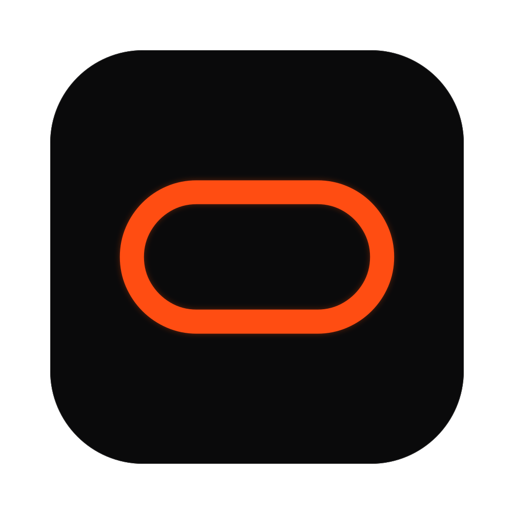

<p align="center">
  
</p>

<h1 align="center">OCULUS</h1>

<p align="center">
  <strong>Every PDF tool. None of the uploads.</strong><br>
  A desktop document toolkit by <a href="https://araskova.com">Araskova</a> that converts, organises and reads
  documents entirely on your own computer.
</p>

<p align="center">
  <a href="https://github.com/ARASKOVA-labs/OCULUS/actions/workflows/release.yml"></a>
  <a href="https://github.com/ARASKOVA-labs/OCULUS/releases"></a>
  <a href="LICENSE"></a>
  
</p>

---

OCULUS merges, splits, compresses, converts, protects, repairs and reads documents, including
Malayalam OCR, without sending a single byte anywhere. There is no account, no server and no
telemetry: **the app makes no network requests.** Confidential contracts, medical records and ID
scans stay on the machine they are on.

## What it does

### Universal document converter

Every conversion runs on your computer and shows you the pages **before** you run it and **after**,
so you can see exactly what you will get.

| From | To | Notes |
|---|---|---|
| Word (`.docx`), Markdown, plain text | PDF | Headings, bold and italic, lists, tables, pictures, page size and margins |
| PowerPoint (`.pptx`) | PDF | One page per slide; text, bullets, pictures, tables and shapes where they sit on the slide |
| Excel (`.xlsx`), CSV | PDF | Every sheet as a table; wide sheets turn landscape; the header row repeats on each page |
| JPG, PNG, WebP, AVIF, TIFF | PDF | Several pictures make one PDF; on desktop a single picture also gets a searchable text layer |
| PDF | JPG, PNG | Every page; several pages come as one ZIP |
| PDF, images | Word, PowerPoint, Excel | Text, tables and page images, with OCR for scans |
| EPUB ⇄ MOBI | | Chapters, title, author, cover and pictures; the EPUB passes the W3C EPUBCheck validator |
| AVIF ⇄ PNG / JPG | | AVIF is encoded with libavif built into the app |

### And the rest

| | |
|---|---|
| **Organise** | Merge, split, remove pages, extract pages, reorder, with each page marked kept or removed in the preview |
| **Optimise** | Compress, repair |
| **Edit** | Rotate, page numbers, watermark |
| **Security** | Protect with a password, unlock |
| **Scanner** | Turn phone photos and scans into clean pages (straightened, shadows removed, black and white or colour), export a PDF, and pull out the text, tables and fields as Excel, CSV or JSON |
| **OCR & extract** | Read text from scans and photos (English, Malayalam and more), pull out tables and form fields |

Press <kbd>⌘K</kbd> (<kbd>Ctrl</kbd>+<kbd>K</kbd> on Windows and Linux) to search every tool, or
drop a file on the home screen and OCULUS suggests what to do with it.

## Install

Download the installer for your system from
[**Releases**](https://github.com/ARASKOVA-labs/OCULUS/releases). Every release lists SHA-256
checksums so you can verify the download.

| System | File | First launch |
|---|---|---|
| **macOS** (Apple Silicon and Intel) | `.dmg` | Drag OCULUS to Applications. Until the app is notarised, right-click it and choose **Open** the first time. |
| **Windows** 10 and 11 (x64) | `-setup.exe` | Until the installer is signed, SmartScreen may warn: choose **More info**, then **Run anyway**. |
| **Linux** (x64) | `.deb` or `.AppImage` | `sudo apt install ./OCULUS_*.deb`, or `chmod +x` the AppImage and run it. |

Every tool works on all three systems. To read a scanned PDF, macOS draws its pages natively;
Windows and Linux draw them inside the app first, so reading long scanned PDFs is slower there.

## Build from source

You need [Rust](https://rustup.rs) (stable), [Bun](https://bun.sh), and Tesseract and Leptonica:

| System | Native dependencies |
|---|---|
| macOS | `brew install tesseract leptonica pkg-config` |
| Debian / Ubuntu 22.04+ | `sudo apt install build-essential pkg-config libssl-dev libxdo-dev libwebkit2gtk-4.1-dev libayatana-appindicator3-dev librsvg2-dev libtesseract-dev libleptonica-dev` |
| Windows | Tesseract and Leptonica through [vcpkg](https://vcpkg.io) (see [RELEASING.md](RELEASING.md)) |

```bash
git clone --recurse-submodules https://github.com/ARASKOVA-labs/OCULUS.git
cd OCULUS
(cd araskova-doccraft && bun install && bun run dev --port 5173) &   # the interface
(cd src-tauri && cargo run)                                          # the desktop app
```

| Task | Command |
|---|---|
| Interface tests | `cd araskova-doccraft && bun run test` |
| Lint | `cd araskova-doccraft && bun run lint` |
| Native tests | `cd src-tauri && cargo test` |
| Installer for your system | see [RELEASING.md](RELEASING.md) |

Every pull request runs the same checks on macOS, Windows and Linux in
[GitHub Actions](.github/workflows/ci.yml). Every push to `main` runs them again, builds the
installers for all three and publishes them as a pre-release
([release.yml](.github/workflows/release.yml)); tagging `vX.Y.Z` drafts a versioned release.

## How it is built

```
React + TypeScript interface   araskova-doccraft/   (the converters live in src/lib/convert/)
  → Tauri 2 desktop shell      src-tauri/
  → Rust application layer     jobs, files, PDF repair and encryption
  → C++ engine                 native/              (Tesseract + Leptonica)
```

The document converters are plain TypeScript with no network access: a small ZIP reader, readers for
Word, Excel, PowerPoint, EPUB and MOBI, and one PDF layout engine (built on
[pdf-lib](https://pdf-lib.js.org)) that draws every document as pages. The previews use the same
engine, so what you see before running a conversion is what you get.

## Known limitations

We would rather tell you than have you find out:

- PDFs that OCULUS **creates** from documents draw Latin and Malayalam text (Noto Sans Malayalam is
  built in, conjuncts and all). Text in other scripts, such as Tamil or Hindi, still shows as `?`,
  and the result says how many characters were affected.
- Word 97–2003 (`.doc`), Excel 97–2003 (`.xls`) and PowerPoint 97–2003 (`.ppt`) are not read. Save
  them in the newer format first.
- PowerPoint charts, SmartArt and effects are not drawn yet.
- MOBI files in Kindle's KF8 (AZW3) format or with Huffman compression are not read yet.
  DRM-protected e-books are refused.
- Protect and Unlock need the desktop app (the browser preview build cannot encrypt PDFs).

## Contributing

Bug reports, fixes, translations, language data and new tools are all welcome. Start with
[CONTRIBUTING.md](CONTRIBUTING.md) and the [Code of Conduct](CODE_OF_CONDUCT.md). Please report
security problems privately, as described in [SECURITY.md](SECURITY.md).

## Licence

OCULUS is free software under the
**[GNU Affero General Public License, version 3](LICENSE)** (AGPL-3.0-only). You may use, study,
change and share it. If you distribute a modified version, or let people use one over a network,
you must make your source code available to them under the same licence.

The names **Araskova** and **OCULUS**, the Rephen O logo and the app icon are trademarks of Araskova
and are not covered by the licence; forks must use their own name and artwork. See
[TRADEMARKS.md](TRADEMARKS.md). Third-party components keep their own licences; see
[THIRD_PARTY_NOTICES.md](THIRD_PARTY_NOTICES.md).
