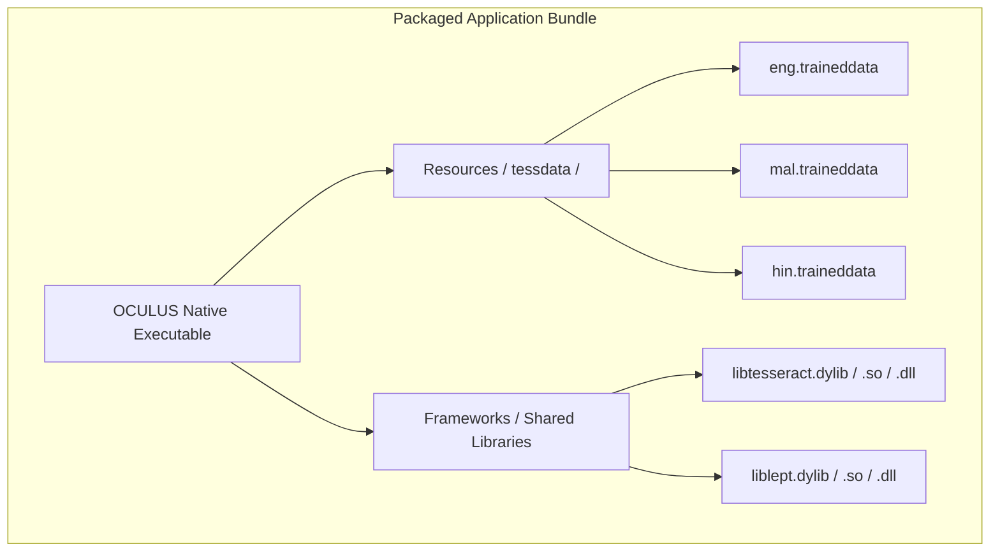

# OCULUS Cross-Platform Distribution Strategy

This document specifies the production distribution architecture for **OCULUS Desktop** across macOS, Linux, and Windows. End users must never be required to install Homebrew, compile C++, or configure environment paths manually.

---

## 1. Native Dependency Packaging Architecture



---

## 2. Model & Tessdata Discovery Hierarchy

The native C++ engine dynamically resolves the traineddata directory at runtime following this strict priority hierarchy:

1. **Explicit Environment Variable**:
   - `OCULUS_TESSDATA` (for containerized or enterprise override deployments).
2. **Application Bundle Resources**:
   - **macOS**: `<Bundle>/Contents/Resources/tessdata/`
   - **Linux**: `<AppDir>/usr/share/tessdata/` (or relative `./tessdata/`)
   - **Windows**: `<ExeDir>\tessdata\`
3. **User Application Data Directory**:
   - **macOS**: `~/Library/Application Support/com.araskova.oculus/tessdata/`
   - **Linux**: `~/.local/share/oculus/tessdata/`
   - **Windows**: `%APPDATA%\Araskova\OCULUS\tessdata\`
4. **System Fallbacks (Development Only)**:
   - `/opt/homebrew/share/tessdata/`
   - `/usr/local/share/tessdata/`
   - `/usr/share/tessdata/`

---

## 3. Platform Distribution Pipelines

### A. macOS (`.dmg` & `.app`)
- **Format**: Signed and notarized Universal (arm64 + x86_64) DMG.
- **Dynamic Libraries**:
  - `libtesseract.5.dylib` and `libleptonica.6.dylib` copied into `OCULUS.app/Contents/Frameworks/`.
  - Binary `rpath` configured via `install_name_tool -add_rpath @executable_path/../Frameworks`.
- **Resources**:
  - Core language models (`eng.traineddata`, `mal.traineddata`) placed in `Contents/Resources/tessdata/`.
  - Configured in `tauri.conf.json`:
    ```json
    "bundle": {
      "resources": ["tessdata/*"]
    }
    ```

### B. Linux (`.AppImage` & `.deb`)
- **Format**: Self-contained `AppImage` executable and Debian package (`.deb`).
- **Shared Libraries**:
  - Bundled inside AppImage filesystem (`AppDir/usr/lib/x86_64-linux-gnu/`).
  - `LD_LIBRARY_PATH` auto-configured by the AppRun bootstrap script.
- **Resources**:
  - Models embedded in `AppDir/usr/share/tessdata/`.

### C. Windows (`.msi` & Portable `.zip`)
- **Format**: WiX toolset MSI installer.
- **DLLs**:
  - `tesseract50.dll`, `leptonica-1.82.0.dll` placed alongside `oculus-desktop.exe`.
- **Resources**:
  - Embedded `tessdata\` folder created in installation directory (`C:\Program Files\OCULUS\tessdata\`).

---

## 4. Upgrade & Uninstall Guarantees
- Clean uninstallation removes application binaries and system configurations.
- User datasets and exported JSONL files remain in user-selected directories and are never touched by uninstallation.
